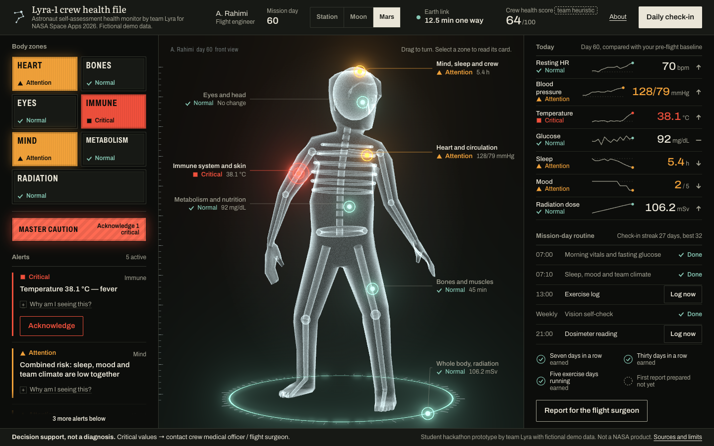

# Astronaut Self-Assessment Health Monitor

**Live demo:** https://osiyasadulloeva3-arch.github.io/lyra-health-monitor/



## What it does

- A crew member far from Earth types in a few daily readings: pulse, blood pressure, temperature, glucose, sleep, mood, radiation dose.
- The app compares each reading with a sourced reference range and with the crew member's own pre-flight baseline.
- Seven body zones on a 3D figure show Normal, Attention or Critical, always as colour, icon and word together.
- Every alert says why it fired, what to do next, and where its limit comes from.
- A report for the flight surgeon (PDF and JSON) waits in a queue while the link to Earth is down; the whole app works offline.

## About

Team Lyra's prototype for NASA Space Apps Challenge 2026 (Dushanbe). A crew member far from Earth types in a few
daily readings; the app compares them with sourced reference ranges and with their own pre-flight baseline, shows
seven body zones as Normal / Attention / Critical, and prepares a report for the flight surgeon that can wait in a
queue while the link to Earth is down.

**Decision support, not a diagnosis. Critical values → contact crew medical officer / flight surgeon.**
Student hackathon prototype with fictional demo data. Not a NASA product and not endorsed by NASA.

The idea and the feature list belong to team Lyra (`docs/TEAM_CONCEPT.md`). The code was written with AI
assistance; see `AI_USAGE.md`.

## Run it

No build step and no installation.

```
cd app
python3 -m http.server 8765
```

Open http://localhost:8765/ in Chrome, Edge, Safari or Firefox. After the first load the app works with the
network switched off (service worker); data stays in the browser's `localStorage`.

## What is inside

- **Body view.** A 3D figure with seven zones: heart, bones and muscle, eyes, immune system and skin, mind and
  sleep, metabolism, whole-body radiation. Hover or tap a zone, or use the zone list with the keyboard. Without
  WebGL, or with "reduce motion" switched on, a flat drawing with the same zones is shown.
- **Zone card.** What spaceflight does to that zone, why it has its status today, the reading against the
  personal baseline, a chart for 7 / 30 / all days, and the source of every limit.
- **Alerts.** Reference-range, personal-baseline, 7-day trend and a combined rule (sleep + mood + team climate).
  Each alert explains itself under "Why am I seeing this?". A Critical alert keeps the Master Caution lamp lit until it is acknowledged.
- **Daily check-in** with input validation, a weekly vision self-check, streak and badges.
- **Environment switch.** Station / Moon / Mars changes the radiation dose rate and the communication delay.
- **Report for the flight surgeon.** JSON and PDF, with a simulated send queue for communication blackouts.
- **Sources and limits.** Every threshold with its source; anything unverified is marked "team heuristic" or
  "placeholder — not verified".

## Files

| Path | What |
|---|---|
| `index.html`, `css/`, `js/` | the app (plain HTML, CSS, ES modules) |
| `data/thresholds.json` | every limit, its source and quote; change a number here, not in code |
| `data/knowledge.json` | zone texts |
| `data/demo.js` | the fictional 60-day history |
| `js/rules.js` | rules engine; tests: `node tests/rules.test.mjs` |
| `sw.js` | offline cache; regenerate the file list with `node tools/gen-sw.mjs` after any change |
| `vendor/`, `assets/` | libraries, fonts and the body model, stored locally with their licenses |
| `SOURCES.md` | thresholds, quotes, licenses, credits |
| `QUESTIONS_FOR_TEAM.md` | open questions and the simple reading used for each |
| `DESIGN.md` | art direction and tokens |
| `docs/screenshots/` | screens at 1440×900 and 390×844 |

## Limits

- Nothing is measured by the app; every reading is typed in.
- Reference ranges are general clinical references for adults on Earth.
- The astronaut, the mission and the data are invented.
- Sending a report is simulated; the app makes no network requests at runtime.
